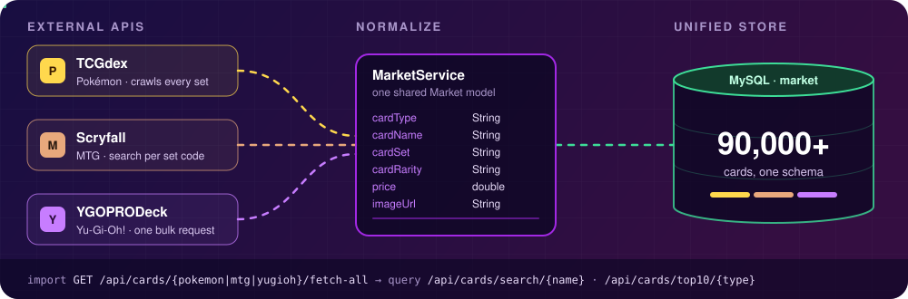
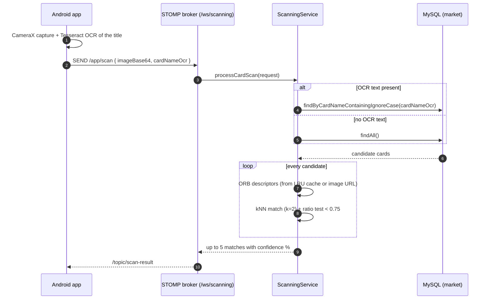
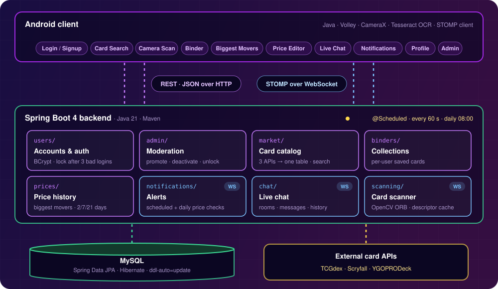
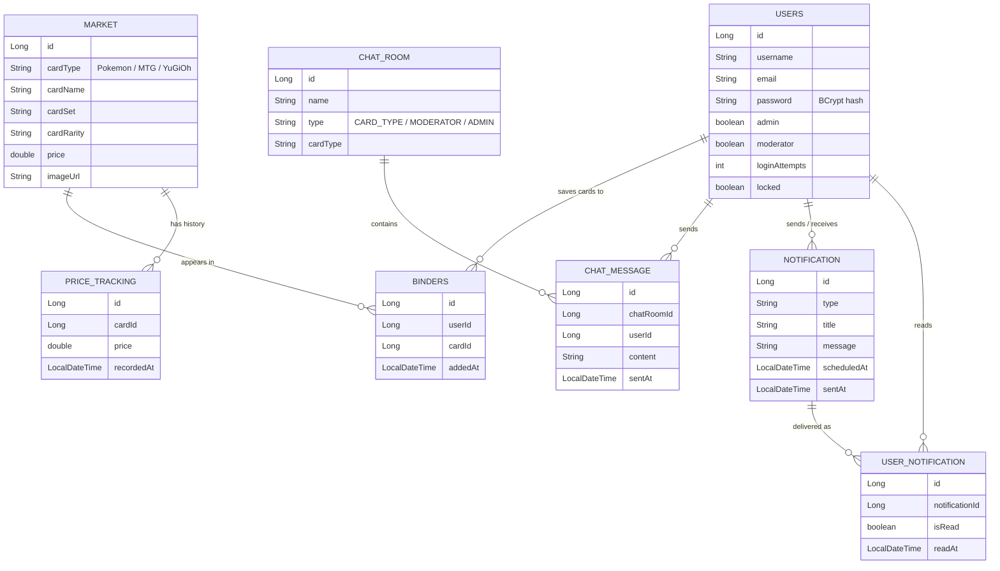

<div align="center">



<br/>


**A stock-market-style marketplace for Pokémon, Magic: The Gathering, and Yu-Gi-Oh! cards.**<br/>
Browse 90,000+ cards in one place, track prices like tickers, scan physical cards with your phone's camera,<br/>
and trade notes with other collectors in real time.

Built as a team project for **COM S 309 (Software Development Practices)** at Iowa State University.

[**▶ Watch the demo**](https://youtu.be/El1KD3GnCjg) · [Architecture](#architecture) · [API docs](Documents/API.md) · [CI/CD](Documents/CI-CD.md) · [Run it](#running-the-project)

</div>

---

## Demo

<div align="center">
  <a href="https://youtu.be/El1KD3GnCjg">
    
  </a>
  <br/>
  <sub>Click to watch the full application walkthrough on YouTube.</sub>
</div>

## What it does

| | Feature | What you get |
|:-:|---|---|
| 🗂️ | **Unified card catalog** | Pokémon, MTG, and Yu-Gi-Oh! data from three public APIs, normalized into one searchable table |
| 📈 | **Price tracking** | Price history per card plus "biggest movers" over 2, 7, and 21 days, split into gainers and losers |
| 📷 | **Card scanning** | Photograph a physical card and get the closest matches using OCR + OpenCV feature matching |
| 📒 | **Binders** | Save cards to a personal collection and keep an eye on their value |
| 🔔 | **Price alerts** | A daily job notifies you when a card in your binder moves more than 1% |
| 💬 | **Real-time chat** | Per-game chat rooms over WebSockets, with message history saved between sessions |
| 🛡️ | **Roles & moderation** | User, moderator, and admin roles; admins can promote, deactivate, and unlock accounts |
| 🚀 | **CI/CD** | Every push to `main` builds the backend and deploys it to the production server |

## How it works

### 1. Three card APIs, one marketplace



Each trading card game has its own data source with its own shape:

- **TCGdex** (Pokémon) is crawled set by set, then card by card.
- **Scryfall** (MTG) is queried per set code.
- **YGOPRODeck** (Yu-Gi-Oh!) returns its whole catalog in a single request.

`MarketService` maps all three into one `Market` entity (`cardType`, `cardName`, `cardSet`, `cardRarity`, `price`, `imageUrl`). The rest of the app (search, top 10 per game, binders, price history, scanning) works the same no matter which game a card comes from.

### 2. Scan a card with your camera



Scanning combines **OCR** to narrow the search and **computer vision** to make the final match:

1. **Capture.** The Android app takes a photo with CameraX.
2. **Read the name.** Tesseract OCR reads the card's title strip on the device.
3. **Send.** The Base64 image and the OCR'd name go to the backend over STOMP (`/app/scan` on `/ws/scanning`, with a 10 MB message limit).
4. **Match.** The backend narrows the catalog to cards whose names contain the OCR text. It then extracts **ORB** features (up to 1,000 keypoints) from the photo and compares them to each candidate using a brute-force Hamming **kNN** matcher with **Lowe's ratio test** (0.75).
5. **Rank.** Each candidate's score is its good-match count divided by the photo's keypoint count. Up to five matches that score at least 10% of the best one are sent back on `/topic/scan-result`, each with a confidence relative to the top match.

Candidate descriptors are kept in a **500-entry LRU cache** that is warmed in the background at startup, so repeat scans skip re-downloading and re-processing card images.

<details>
<summary><b>Scan sequence diagram</b></summary>



</details>

### 3. Prices that move like a stock ticker



- Every price snapshot is stored as a `PriceTracking` row, which gives each card a full history.
- **Biggest movers** compares each card's latest price with an earlier one and returns the top 10 by percentage change. It supports 2-, 7-, and 21-day windows, gainers or losers only, and a filter by game.
- A **scheduled job runs every day at 08:00**. It checks every card in every user's binder and sends a `Card Price Update` notification when the change exceeds **1%**. Notifications go out live over WebSockets and are also stored, so unread ones are still there later.

### 4. Real-time chat and notifications



Chat, notifications, and scanning all run on Spring's STOMP message broker. Clients `SEND` to `/app/...` destinations and `SUBSCRIBE` to `/topic/...` channels. Chat rooms exist for each card game, plus dedicated moderator and admin rooms. Every message is saved as a `ChatMessage`, so `GET /chat/rooms/{roomId}/history` restores the conversation when you return.

## Architecture



The backend is a Spring Boot application split into one package per feature: each has its own controller, service, repository, and entity. REST endpoints handle request/response work such as accounts, the catalog, binders, and prices. STOMP over WebSocket handles anything pushed from the server: chat, notifications, and scan results. Spring's `@Scheduled` runs two background jobs: one every 60 seconds for queued notifications, and the daily 08:00 binder price check.

<details>
<summary><b>Data model</b></summary>



</details>

<details>
<summary><b>API at a glance</b> (full reference in <a href="Documents/API.md">Documents/API.md</a>)</summary>

| Area | REST endpoints | Real-time |
|---|---|---|
| **Users** | `POST /users/signup` · `POST /users/login` · `PUT /users/{id}/change-password` · `PUT /users/{id}/change-email` · `POST /users/reset-password` · `DELETE /users/{id}/delete-account` | |
| **Admin** | `GET /admin/users` · `PUT /admin/users/{id}/promote` · `…/demote` · `…/activate` · `…/deactivate` · `POST /admin/users/{id}/unlock` | |
| **Cards** | `GET /api/cards` · `GET /api/cards/search/{name}` · `GET /api/cards/type/{type}` · `GET /api/cards/top10/{type}` · `GET /api/cards/{pokemon\|mtg\|yugioh}/fetch-all` | |
| **Binders** | `GET /api/users/{username}/binder` · `POST /api/users/{username}/binder` · `DELETE /api/users/{username}/binder/{cardId}` | |
| **Prices** | `GET /api/prices/card/{cardId}` · `GET /api/prices/card/{cardId}/latest` · `GET /api/prices/biggest-movers[/2days\|/7days\|/21days\|/gainers\|/losers]` · `GET /api/prices/biggest-movers/type/{type}` | |
| **Chat** | `GET /chat/rooms/{userId}` · `POST /chat/rooms` · `GET /chat/rooms/{roomId}/history` | `/ws/chat` → `/topic/chat/{roomId}` |
| **Notifications** | `GET /notifications/user/{userId}` · `GET /notifications/unread/{userId}` · `PUT /notifications/{id}/read` | `/ws/notifications` → `/topic/notifications[/{username}]` |
| **Scanning** | `POST /scan/debug` | `/ws/scanning` · `SEND /app/scan` → `/topic/scan-result` |

Interactive docs are available from springdoc at `/swagger-ui-custom.html` (OpenAPI JSON at `/api-docs`) while the backend is running.

</details>

## CI/CD



GitLab CI runs on every push to `main`:

- **build** packages the Spring Boot JAR with Maven, caching `.m2` between runs.
- **deploy** syncs `Backend/` to the class server with `rsync` and restarts the JAR inside a detached `screen` session named `nerdmarket`. It fails the pipeline if the session doesn't come up.

The team's Discord channel gets a notice when a deploy starts, succeeds, or fails; failure notices link to the pipeline logs. See [Documents/CI-CD.md](Documents/CI-CD.md) for details.

## Tech Stack

| Layer | Technologies |
|---|---|
| **Backend** | Java 21, Spring Boot 4, Spring Web, Spring Data JPA, Hibernate, Spring WebSocket (STOMP), Spring Security Crypto (BCrypt), Lombok, springdoc-openapi |
| **Database** | MySQL |
| **Computer vision** | OpenCV 4.9 (ORB, BFMatcher), Tesseract OCR on device (tesseract4android) |
| **Android client** | Java, Volley, CameraX, STOMP client, Material Components |
| **External APIs** | [TCGdex](https://tcgdex.dev), [Scryfall](https://scryfall.com/docs/api), [YGOPRODeck](https://ygoprodeck.com/api-guide/) |
| **Build & DevOps** | Maven, Gradle, GitLab CI/CD, rsync + GNU Screen, Discord webhooks |

## Running the Project

### Backend

**Requirements:** Java 21, Maven (or the bundled wrapper), MySQL

1. Point `spring.datasource.*` in `Backend/src/main/resources/application.properties` at your MySQL instance. Hibernate creates the tables on first run (`ddl-auto=update`).
2. Start the server from the `Backend` directory:

   ```bash
   cd Backend
   ./mvnw spring-boot:run
   ```

3. The API is served on `http://localhost:8080`. Load card data with the `fetch-all` endpoints, for example `GET /api/cards/pokemon/fetch-all`.

### Android app

The Android client lives in `Frontend/`. Open it in Android Studio, or build it from the command line:

```bash
cd Frontend
./gradlew build
```

## Repository Structure

```text
NerdMarket/
├── Backend/                 # Spring Boot backend
│   └── src/main/java/NerdMarket/
│       ├── users/           # signup, login, account management
│       ├── admin/           # roles, activation, unlocking
│       ├── market/          # card catalog + external API import
│       ├── binders/         # personal collections
│       ├── prices/          # price history + biggest movers
│       ├── notifications/   # alerts, schedulers, WebSocket push
│       ├── chat/            # rooms, messages, STOMP chat
│       ├── scanning/        # OpenCV matcher + WebSocket config
│       └── debugging/       # logging + global error handling
├── Frontend/                # Android application
├── Documents/               # API + CI/CD docs, design doc, Javadoc, coverage reports
│   └── readme-assets/       # animated SVGs used in this README
├── Experiments/             # individual tutorial and prototype work
└── .gitlab-ci.yml           # build + deploy pipeline
```

## What This Project Demonstrates

- **REST API design** across eight feature areas, with consistent controller → service → repository layering
- **Relational data modeling** with JPA/Hibernate on MySQL
- **Third-party API integration**: normalizing three differently shaped card APIs into one model
- **Real-time systems** with STOMP over WebSockets for chat, notifications, and scan results
- **Computer vision**: OCR-assisted candidate filtering plus ORB feature matching, with descriptor caching
- **Backend automation** with scheduled jobs for notifications and price alerts
- **CI/CD**: automated build and deploy to a live server, with team notifications
